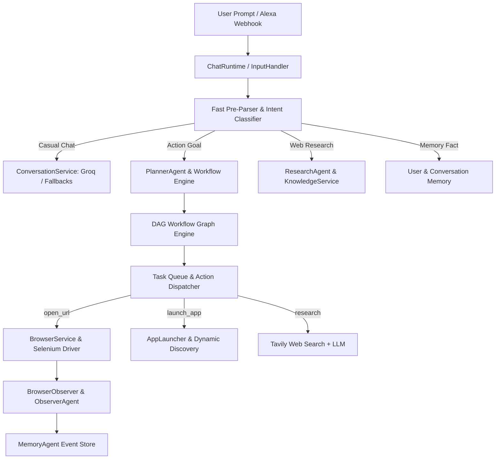

# 🧠 AIVA (Artificial Intelligence Virtual Assistant)

**AIVA** is a modular, event-driven, autonomous multi-agent assistant designed for high-performance interaction, intelligent workflow planning, desktop application execution, web search, and persistent multi-tiered memory.

---

## 🌟 How the Current Version Works

AIVA is built around an **Event-Driven Micro-Kernel** architecture (`AIVAKernel`). When a user submits a prompt, it moves through a multi-stage pipeline:



---

## 🏗️ Core Architectural Components

### 1. ⚡ Instant Compound Intent Pre-Parser & Intelligence Router
- **Fast Intent Pre-Parser**: Instant `<1ms` local parser for site-specific searches and desktop app launches.
  - **YouTube Search**: `"open youtube, search python"` → opens `https://www.youtube.com/results?search_query=python`.
  - **Google Search**: `"open google and search AI"` → opens `https://www.google.com/search?q=AI`.
  - **Amazon / GitHub / Wikipedia Search**: Automatically formats search query parameters into target URLs.
  - **Desktop Apps**: `"open notepad"`, `"open vscode"`, `"open calculator"` → triggers OS application launching.
- **Intent Classifier Service**: Classifies prompts into `conversation`, `knowledge`, `research`, `action`, `memory_write`, and `memory_read` using Gemini Flash Lite with fast heuristic fallbacks.

### 2. 🛡️ Multi-Provider Resilient LLM Engine
AIVA implements cross-provider failover logic so requests never fail due to model deprecation or API rate limits:
- **Groq API**: Primary conversational provider using `openai/gpt-oss-20b` with candidate fallbacks (`groq/compound-mini`, `qwen/qwen3.6-27b`).
- **Gemini API**: Used for fast intent classification (`gemini-2.5-flash-lite`) and instant LLM fallbacks.
- **Mistral API**: Used for complex workflow planning and knowledge extraction with instant HTTP 429 rate-limit fallback to Gemini/Groq.

### 3. 🕸️ DAG Workflow Engine & Agent Framework
- **`PlannerAgent`**: Converts arbitrary multi-step goals into a Directed Acyclic Graph (`WorkflowGraph`).
- **`WorkflowEngine`**: Manages node dependencies, task queues, checkpoint saves (`state/checkpoints/`), and step recoveries.
- **`ActionDispatcher` & `CapabilityRegistry`**: Maps node actions (`open_url`, `launch_app`, `research`) to core execution services.
- **`ResearchAgent`**: Combines Tavily web search with LLM report synthesis.
- **`BrowserAgent` & `ObserverAgent`**: Automates Chrome browser actions and observes DOM/URL changes (`youtube.detected`, `browser_url_changed`).

### 4. 🧠 Multi-Tiered Persistent Memory Architecture
- **`UserMemoryService`** (`memory/user_memory.json`): Stores user preferences, name, facts, and identity.
- **`ConversationMemoryService`** (`memory/conversation_memory.json`): Stores short-term and long-term conversation turns.
- **`KnowledgeService`** (`memory/knowledge_memory.json`): Caches synthesized web search reports and entity knowledge.
- **`MemoryService`** (`memory/runtime_memory.json`): Manages active runtime state.

### 5. 💻 Desktop Application & OS Integration
- **`AppLauncher`** (`tools/app_launcher.py`): Non-blocking cross-platform application launcher (`windows_apps.json`, `linux_apps.json`). Includes dynamic Windows Start Menu app discovery.
- **`ConfigLoader`** (`core/shared/config_loader.py`): Centralized, deterministic path loader for workspace-independent path resolution.

### 6. 🖥️ Synchronized Terminal User Interface
- **`ChatRuntime`** (`core/interaction/chat_runtime.py`): Monitored prompt loop that waits for background tasks and observer logs to complete before displaying `You: `, ensuring clean, readable terminal output.

---

## 📁 Repository Directory Structure

```text
aiva/
├── main.py                     # Main terminal application entry point
├── aiva_server.py              # Flask HTTP webhook listener for external integrations (e.g. Alexa)
├── config/
│   ├── secrets.json            # API keys (Groq, Gemini, Mistral, Tavily)
│   ├── windows_apps.json       # App mappings for Windows
│   └── linux_apps.json         # App mappings for Linux
├── core/
│   ├── runtime/
│   │   ├── kernel.py           # AIVAKernel runtime engine
│   │   ├── event_bus.py        # Asynchronous event bus
│   │   ├── state_manager.py    # Global runtime state manager
│   │   ├── task_queue.py       # Asynchronous task queue
│   │   └── scheduler.py        # Ticking scheduler loop
│   ├── agents/
│   │   ├── agent_manager.py    # Agent lifecycle manager
│   │   ├── planner_agent.py    # Workflow planning agent
│   │   ├── research_agent.py   # Web research agent
│   │   ├── browser_agent.py    # Browser execution agent
│   │   ├── observer_agent.py   # DOM & URL observer agent
│   │   └── memory_agent.py     # Real-time event memory agent
│   ├── planning/
│   │   ├── workflow_engine.py  # DAG graph execution engine
│   │   ├── workflow_graph.py   # Workflow graph structure
│   │   └── dependency_resolver.py # Node dependency resolver
│   ├── execution/
│   │   ├── action_dispatcher.py # Capability action dispatcher
│   │   └── capability_registry.py # Capability registry
│   ├── interaction/
│   │   ├── chat_runtime.py     # Terminal prompt runtime with prompt sync
│   │   └── input_handler.py    # Intent router & prompt processor
│   └── shared/
│       ├── config_loader.py    # Deterministic workspace path resolution
│       └── logger.py           # Standardized logger
├── services/
│   ├── conversation_service.py # Groq conversational service with fallbacks
│   ├── intent_classifier_service.py # Gemini & heuristic intent classifier
│   ├── mistral_service.py      # Workflow generator with instant rate-limit fallback
│   ├── browser_service.py      # Selenium Chrome browser automation service
│   ├── tavily_service.py       # Non-blocking Tavily web search service
│   ├── knowledge_service.py    # Knowledge synthesis & caching service
│   └── user_memory_service.py  # Persistent user memory store
├── tools/
│   ├── app_launcher.py         # OS application launcher
│   ├── app_discovery.py        # Dynamic Windows start menu search
│   ├── browser_tool.py         # Standalone browser helper
│   └── file_manager.py        # File manipulation tools
├── memory/                     # JSON persistent data stores
└── state/                      # System checkpoints and runtime state
```

---

## 🚀 Getting Started

### 1. Prerequisites
- Python 3.10+
- Google Chrome & ChromeDriver (for browser automation)

### 2. Configuration
Ensure your API keys are configured in `config/secrets.json`:
```json
{
    "mistral_api_key": "YOUR_MISTRAL_KEY",
    "tavily_api_key": "YOUR_TAVILY_KEY",
    "groq_api_key": "YOUR_GROQ_KEY",
    "gemini_api_key": "YOUR_GEMINI_KEY"
}
```

### 3. Running AIVA

#### Interactive Terminal Interface:
```bash
python main.py
```

#### Alexa / External Webhook Server:
```bash
python aiva_server.py
```

---

## 💬 Example Commands

| Command Type | Example Input | Execution Behavior |
| :--- | :--- | :--- |
| **Casual Conversation** | `"Hello AIVA, how are you today?"` | Fast conversational LLM response via Groq with conversation context. |
| **Compound Site Search** | `"open youtube, search for python"` | Instantly opens Chrome to `https://www.youtube.com/results?search_query=python`. |
| **Desktop Application** | `"open notepad"` | Launches Windows Notepad application asynchronously. |
| **Web Research** | `"research latest artificial intelligence news"` | Executes Tavily search, synthesizes research via LLM, and stores facts in knowledge memory. |
| **Persistent User Memory** | `"Remember my name is Charan"` | Saves user fact into `memory/user_memory.json` for future conversations. |
