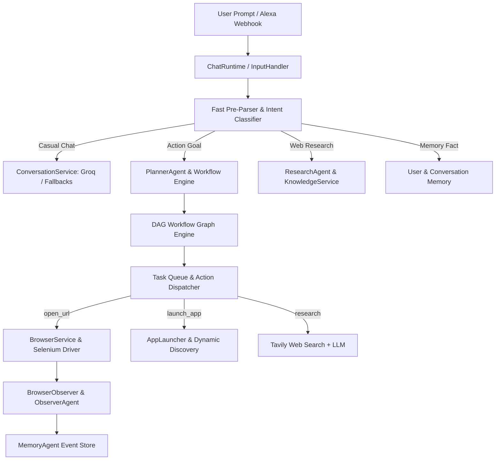

# 🧠 AIVA (Artificial Intelligence Virtual Assistant)

**AIVA** is a modular, event-driven, autonomous multi-agent assistant designed for high-performance interaction, intelligent workflow planning, desktop application execution, web search, and persistent multi-tiered memory.

---

## 🌟 How the Current Version Works

AIVA is built around an **Event-Driven Micro-Kernel** architecture (`AIVAKernel`). When a user submits a prompt, it moves through a multi-stage pipeline:



---

## 🏗️ Core Architectural Components

### 1. ⚡ Instant Compound Intent Pre-Parser & Intelligence Router
- **Fast Intent Pre-Parser**: Instant `<1ms` local parser for site-specific searches and desktop app launches.
  - **YouTube Search**: `"open youtube, search python"` → opens `https://www.youtube.com/results?search_query=python`.
  - **Google Search**: `"open google and search AI"` → opens `https://www.google.com/search?q=AI`.
  - **Amazon / GitHub / Wikipedia Search**: Automatically formats search query parameters into target URLs.
  - **Desktop Apps**: `"open notepad"`, `"open vscode"`, `"open calculator"` → triggers OS application launching.
- **Intent Classifier Service**: Classifies prompts into `conversation`, `knowledge`, `research`, `action`, `memory_write`, and `memory_read` using Gemini Flash Lite with fast heuristic fallbacks.

### 2. 🛡️ Multi-Provider Resilient LLM Engine
AIVA implements cross-provider failover logic so requests never fail due to model deprecation or API rate limits:
- **Groq API**: Primary conversational provider using `openai/gpt-oss-20b` with candidate fallbacks (`groq/compound-mini`, `qwen/qwen3.6-27b`).
- **Gemini API**: Used for fast intent classification (`gemini-2.5-flash-lite`) and instant LLM fallbacks.
- **Mistral API**: Used for complex workflow planning and knowledge extraction with instant HTTP 429 rate-limit fallback to Gemini/Groq.

### 3. 🕸️ DAG Workflow Engine & Agent Framework
- **`PlannerAgent`**: Converts arbitrary multi-step goals into a Directed Acyclic Graph (`WorkflowGraph`).
- **`WorkflowEngine`**: Manages node dependencies, task queues, checkpoint saves (`state/checkpoints/`), and step recoveries.
- **`ActionDispatcher` & `CapabilityRegistry`**: Maps node actions (`open_url`, `launch_app`, `research`) to core execution services.
- **`ResearchAgent`**: Combines Tavily web search with LLM report synthesis.
- **`BrowserAgent` & `ObserverAgent`**: Automates Chrome browser actions and observes DOM/URL changes (`youtube.detected`, `browser_url_changed`).

### 4. 🧠 Multi-Tiered Persistent Memory Architecture
- **`UserMemoryService`** (`memory/user_memory.json`): Stores user preferences, name, facts, and identity.
- **`ConversationMemoryService`** (`memory/conversation_memory.json`): Stores short-term and long-term conversation turns.
- **`KnowledgeService`** (`memory/knowledge_memory.json`): Caches synthesized web search reports and entity knowledge.
- **`MemoryService`** (`memory/runtime_memory.json`): Manages active runtime state.

### 5. 💻 Desktop Application & OS Integration
- **`AppLauncher`** (`tools/app_launcher.py`): Non-blocking cross-platform application launcher (`windows_apps.json`, `linux_apps.json`). Includes dynamic Windows Start Menu app discovery.
- **`ConfigLoader`** (`core/shared/config_loader.py`): Centralized, deterministic path loader for workspace-independent path resolution.

### 6. 🖥️ Synchronized Terminal User Interface
- **`ChatRuntime`** (`core/interaction/chat_runtime.py`): Monitored prompt loop that waits for background tasks and observer logs to complete before displaying `You: `, ensuring clean, readable terminal output.

---

## 📁 Repository Directory Structure

```text
aiva/
├── main.py                     # Main terminal application entry point
├── aiva_server.py              # Flask HTTP webhook listener for external integrations (e.g. Alexa)
├── config/
│   ├── secrets.json            # API keys (Groq, Gemini, Mistral, Tavily)
│   ├── windows_apps.json       # App mappings for Windows
│   └── linux_apps.json         # App mappings for Linux
├── core/
│   ├── runtime/
│   │   ├── kernel.py           # AIVAKernel runtime engine
│   │   ├── event_bus.py        # Asynchronous event bus
│   │   ├── state_manager.py    # Global runtime state manager
│   │   ├── task_queue.py       # Asynchronous task queue
│   │   └── scheduler.py        # Ticking scheduler loop
│   ├── agents/
│   │   ├── agent_manager.py    # Agent lifecycle manager
│   │   ├── planner_agent.py    # Workflow planning agent
│   │   ├── research_agent.py   # Web research agent
│   │   ├── browser_agent.py    # Browser execution agent
│   │   ├── observer_agent.py   # DOM & URL observer agent
│   │   └── memory_agent.py     # Real-time event memory agent
│   ├── planning/
│   │   ├── workflow_engine.py  # DAG graph execution engine
│   │   ├── workflow_graph.py   # Workflow graph structure
│   │   └── dependency_resolver.py # Node dependency resolver
│   ├── execution/
│   │   ├── action_dispatcher.py # Capability action dispatcher
│   │   └── capability_registry.py # Capability registry
│   ├── interaction/
│   │   ├── chat_runtime.py     # Terminal prompt runtime with prompt sync
│   │   └── input_handler.py    # Intent router & prompt processor
│   └── shared/
│       ├── config_loader.py    # Deterministic workspace path resolution
│       └── logger.py           # Standardized logger
├── services/
│   ├── conversation_service.py # Groq conversational service with fallbacks
│   ├── intent_classifier_service.py # Gemini & heuristic intent classifier
│   ├── mistral_service.py      # Workflow generator with instant rate-limit fallback
│   ├── browser_service.py      # Selenium Chrome browser automation service
│   ├── tavily_service.py       # Non-blocking Tavily web search service
│   ├── knowledge_service.py    # Knowledge synthesis & caching service
│   └── user_memory_service.py  # Persistent user memory store
├── tools/
│   ├── app_launcher.py         # OS application launcher
│   ├── app_discovery.py        # Dynamic Windows start menu search
│   ├── browser_tool.py         # Standalone browser helper
│   └── file_manager.py        # File manipulation tools
├── memory/                     # JSON persistent data stores
└── state/                      # System checkpoints and runtime state
```

---

## 🚀 Getting Started

### 1. Prerequisites
- Python 3.10+
- Node.js 18+ & npm (for building the Windows Device Agent)
- Google Chrome & ChromeDriver (for local browser automation)

### 2. Configuration & Secrets
Copy `.env.example` to `.env` in the project root:
```bash
cp .env.example .env
```
Configure your environment variables in `.env` (**never commit `.env`**):
```env
BREVO_API_KEY=               # Brevo transactional API key for sending email OTPs
BREVO_SENDER_EMAIL=          # Verified sender email in your Brevo account
BREVO_SENDER_NAME=           # Name displayed in OTP emails (e.g. AIVA Assistant)
JWT_SECRET=                  # Strong random hex string for signing JWT tokens
JWT_ACCESS_EXPIRY_MINUTES=30 # Access token validity in minutes
JWT_REFRESH_EXPIRY_DAYS=30   # Refresh token validity in days
AIVA_HOST=0.0.0.0
AIVA_PORT=5000
GROQ_API_KEY=                # Optional if defined in config/secrets.json
MISTRAL_API_KEY=             # Optional if defined in config/secrets.json
GEMINI_API_KEY=              # Optional if defined in config/secrets.json
TAVILY_API_KEY=              # Optional if defined in config/secrets.json
```

---

## 🖥️ AIVA Windows Device Agent (Companion App)

The **AIVA Device Agent** connects any Windows computer to your cloud-deployed AIVA instance via an outbound real-time WebSocket connection. It allows AIVA to execute local desktop actions (open apps, launch URLs in default browser, control volume/media, capture screenshots, and open files) securely on your machine with a strict local capability allowlist and native confirmation popups.

### 1. Installing & Running in Development:
```bash
cd windows-agent
npm install
npm start
```

### 2. Building the Windows Installer (`.exe`):
To generate the standalone NSIS Windows installer:
```bash
cd windows-agent
$env:CSC_IDENTITY_AUTO_DISCOVERY="false" # On PowerShell
npm run build
```
The resulting installer is generated at:
`windows-agent/dist/AIVA Device Agent Setup 1.0.0.exe`

An unpacked standalone folder is also generated at:
`windows-agent/dist/win-unpacked/AIVA Device Agent.exe`

---

## ☁️ Oracle Cloud Deployment & WSS Configuration

### 1. Ports to Open in Oracle VCN Security List & Ubuntu Firewall:
- Port `80` (HTTP)
- Port `443` (HTTPS)
- Port `5000` (AIVA Server)

```bash
sudo iptables -I INPUT 6 -m state --state NEW -p tcp --dport 5000 -j ACCEPT
sudo netfilter-persistent save
```

### 2. Running AIVA as a `systemd` Service:
Create `/etc/systemd/system/aiva.service`:
```ini
[Unit]
Description=AIVA Cloud Master Engine
After=network.target

[Service]
User=ubuntu
WorkingDirectory=/home/ubuntu/aiva
ExecStart=/home/ubuntu/aiva/venv/bin/python aiva_server.py
Restart=always
RestartSec=3
EnvironmentFile=/home/ubuntu/aiva/.env

[Install]
WantedBy=multi-user.target
```
Enable and start:
```bash
sudo systemctl daemon-reload
sudo systemctl enable aiva
sudo systemctl start aiva
```

### 3. Reverse Proxy & WebSocket (WSS) Configuration:

#### Option A: Cloudflare Tunnel (Recommended — Zero Port Forwarding):
Cloudflare Tunnel natively passes WebSockets with zero extra configuration:
```bash
cloudflared tunnel --url http://localhost:5000
```
This generates an `https://<subdomain>.trycloudflare.com` URL that handles both `https://` REST APIs and `wss://` WebSockets at `/ws/device`.

#### Option B: Caddy Reverse Proxy with Automatic HTTPS & WSS (Recommended for Oracle Cloud):
Caddy automatically provisions and renews Let's Encrypt TLS certificates, and natively handles WebSocket upgrades without manual header rewriting.

1. **Open Ports 80 & 443 in Oracle Cloud VM Firewall**:
```bash
sudo iptables -I INPUT 6 -m state --state NEW -p tcp --dport 80 -j ACCEPT
sudo iptables -I INPUT 6 -m state --state NEW -p tcp --dport 443 -j ACCEPT
sudo netfilter-persistent save
```
*(Also ensure Ingress rules for TCP 80 & 443 are added to your Oracle Cloud VCN Security List).*

2. **Install Caddy & Configure `/etc/caddy/Caddyfile`**:
```bash
sudo apt install -y debian-keyring debian-archive-keyring apt-transport-https curl
curl -1sLf 'https://dl.cloudsmith.io/public/caddy/stable/gpg.key' | sudo gpg --dearmor -o /usr/share/keyrings/caddy-stable-archive-keyring.gpg
curl -1sLf 'https://dl.cloudsmith.io/public/caddy/stable/debian.deb.txt' | sudo tee /etc/apt/sources.list.d/caddy-stable.list
sudo apt update && sudo apt install caddy
```

3. **Caddyfile Configuration** (`/etc/caddy/Caddyfile`):
```caddy
your-aiva-domain.com {
    # Reverse proxy both HTTP/HTTPS and WebSocket WSS to AIVA
    reverse_proxy 127.0.0.1:5000 {
        header_up Host {host}
        header_up X-Real-IP {remote_host}
        header_up X-Forwarded-For {remote_host}
        header_up X-Forwarded-Proto {scheme}
    }
}
```

4. **Start Caddy Service**:
```bash
sudo systemctl daemon-reload
sudo systemctl enable --now caddy
sudo systemctl reload caddy
```

#### Option C: Nginx Reverse Proxy with WSS Support:
If using Nginx, ensure the `Upgrade` headers are forwarded:
```nginx
server {
    listen 80;
    server_name your-aiva-domain.com;
    return 301 https://$host$request_uri;
}

server {
    listen 443 ssl http2;
    server_name your-aiva-domain.com;

    ssl_certificate /etc/letsencrypt/live/your-aiva-domain.com/fullchain.pem;
    ssl_certificate_key /etc/letsencrypt/live/your-aiva-domain.com/privkey.pem;

    # Standard Web UI and REST APIs
    location / {
        proxy_pass http://127.0.0.1:5000;
        proxy_set_header Host $host;
        proxy_set_header X-Real-IP $remote_addr;
        proxy_set_header X-Forwarded-For $proxy_add_x_forwarded_for;
        proxy_set_header X-Forwarded-Proto $scheme;
    }

    # WebSocket Real-time Command Channel
    location /ws/ {
        proxy_pass http://127.0.0.1:5000;
        proxy_http_version 1.1;
        proxy_set_header Upgrade $http_upgrade;
        proxy_set_header Connection "upgrade";
        proxy_set_header Host $host;
        proxy_set_header X-Real-IP $remote_addr;
        proxy_set_header X-Forwarded-For $proxy_add_x_forwarded_for;
        proxy_read_timeout 86400s;
        proxy_send_timeout 86400s;
    }
}
```

---

## 🎨 Unified Design System (`tokens.css`)

AIVA uses a shared, zero-dependency design system (`tokens.css`) across both the Web HUD (`ui/tokens.css`) and the Windows Companion App (`windows-agent/src/renderer/tokens.css`):

- **Color Palette & Theme**:
  - **Dark-First Default**: `#0B0D12` base canvas, layered elevation surfaces (`#11141D`, `#181B26`, `#222738`), and low-contrast borders (`rgba(255, 255, 255, 0.08)`).
  - **Single Accent Color**: Calm Indigo/Violet (`#6366F1` with hover `#4F46E5` and focus glow `rgba(99, 102, 241, 0.25)`).
  - **Light Theme**: Seamless toggle with `data-theme="light"` or `prefers-color-scheme` media query.
- **Local Typography**:
  - Bundles the **Inter** font family (Regular 400, Medium 500, SemiBold 600, Bold 700) directly as `.woff2` files inside `ui/fonts/` and `windows-agent/src/renderer/fonts/`.
  - Zero external CDN dependencies ensures 100% offline functionality, privacy, and sub-millisecond font rendering.
- **Micro-Interactions & Accessibility**:
  - Consistent 8px spacing scale, rounded radius tiers (8px / 12px / 16px).
  - High-visibility keyboard focus rings (`var(--focus-ring)`).
  - Smooth 150ms-250ms cubic-bezier transitions with `prefers-reduced-motion` compliance.

---

## 💻 Building the Windows Companion App ("AIVA Device Agent")

The companion app is built on **Electron 33** and packages into an NSIS Windows installer:

### 1. Prerequisites:
- Node.js 18+ (tested on Node 20.x LTS)
- npm 9+

### 2. Run in Development Mode:
```powershell
cd windows-agent
npm install
npm run start
```

### 3. Build Production Installer:
```powershell
cd windows-agent
$env:CSC_IDENTITY_AUTO_DISCOVERY="false"
npm run build
```
The output installer is generated at:
`windows-agent/dist/AIVA Device Agent Setup 1.0.0.exe` (and copied to `storage/downloads/AIVA-Device-Agent-Setup-1.0.0.exe` for web distribution).

### 4. Verification Screenshots:
Automated test scripts capture all application views across dark and light themes:
```powershell
.\windows-agent\node_modules\electron\dist\electron.exe scripts/capture_screenshots.js
```
The resulting high-resolution captures are preserved in `docs/screenshots/`:
- Auth: `login_dark.png`, `login_light.png`, `register_dark.png`, `register_light.png`, `otp_dark.png`, `otp_light.png`, `loading_dark.png`, `error_dark.png`
- Main App: `home_dark.png`, `home_light.png`, `devices_dark.png`, `devices_light.png`, `activity_dark.png`, `activity_light.png`, `settings_dark.png`, `settings_light.png`

---

## 🧪 Automated Testing
Run the complete test suite (unit tests, security tests, API tests, and WebSocket e2e flow):
```bash
python -m unittest discover tests
```

---

## 💬 Example Commands

| Command Type | Example Input | Execution Behavior |
| :--- | :--- | :--- |
| **Casual Conversation** | `"Hello AIVA, how are you today?"` | Fast conversational LLM response via Groq with conversation context. |
| **Compound Site Search** | `"open youtube, search for python"` | Instantly opens Chrome to `https://www.youtube.com/results?search_query=python`. |
| **Desktop Application** | `"open notepad"` | Launches Windows Notepad application asynchronously. |
| **Web Research** | `"research latest artificial intelligence news"` | Executes Tavily search, synthesizes research via LLM, and stores facts in knowledge memory. |
| **Persistent User Memory** | `"Remember my name is Charan"` | Saves user fact into `memory/user_memory.json` for future conversations. |
