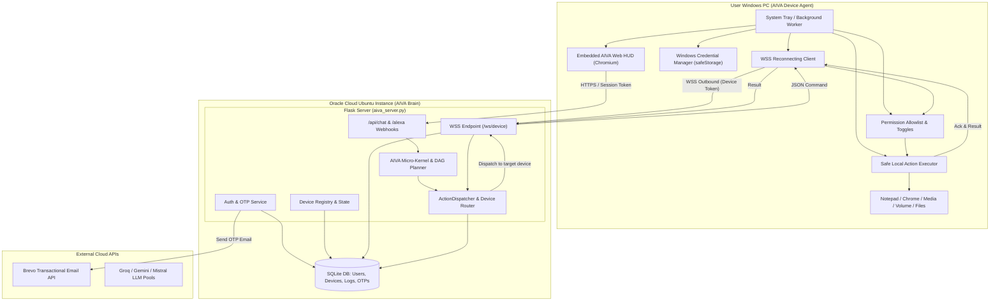

# 🔍 AIVA Device Companion & Cloud Bridge — GAP REPORT

**Date:** November 1, 2026  
**Project:** AIVA (Artificial Intelligence Virtual Assistant)  
**Author:** Senior Full-Stack Engineering  

---

## 1. Executive Summary

AIVA was originally built and operated as a local desktop assistant on Windows. In that setup, capabilities such as launching applications (`tools/app_launcher.py`), controlling audio and taking screenshots (`tools/system_controller.py`), driving UI interactions (`tools/ui_controller.py`), and opening URLs directly manipulated the local Windows host.

Following deployment to an Oracle Cloud Ubuntu Linux instance, these local desktop capabilities broke: the cloud server runs headlessly on Linux and cannot access or control the user's local Windows workstation. Furthermore, AIVA currently possesses no authentication mechanism, no user accounts, and no remote device connection channel.

This report establishes the current repository state, identifies critical gaps, highlights operational and security risks, and outlines the end-to-end architecture for the **AIVA Device Agent** (Windows companion app + cloud WebSocket bridge + Brevo-powered OTP authentication).

---

## 2. Current State Analysis

### 2.1 Technology Stack & Directory Structure
- **Backend Framework:** Python 3.10+ with Flask (`aiva_server.py`), `asyncio` background kernel (`AIVAKernel`), and an EventBus/DAG Workflow engine (`core/`).
- **LLM & Search Integrations:** Multi-provider pool with Groq (`groq`), Mistral (`mistralai`), Google Gemini (`google-genai`), and Tavily (`tavily-python`).
- **Voice Pipeline:** Edge TTS (`edge-tts`), SpeechRecognition (`speech_recognition`), and sounddevice (`sounddevice`).
- **Web UI:** Vanilla HTML5, CSS3, and modern JavaScript (`ui/index.html`, `ui/style.css`, `ui/app.js`), served statically by Flask at `/`.
- **Directory Layout:**
  - `aiva_server.py`: Flask entry point for Web UI HUD, Alexa webhook, and REST API.
  - `main.py`: Terminal CLI interface loop.
  - `core/runtime/`: Micro-kernel (`kernel.py`), event bus (`event_bus.py`), state manager, scheduler, task queue.
  - `core/agents/`: Planner, Research, Browser, Observer, and Memory agents.
  - `core/execution/`: `ActionDispatcher` and `CapabilityRegistry`.
  - `core/interaction/`: `InputHandler` and `ChatRuntime`.
  - `services/`: Conversation, intent routing, intent classification, memory extraction, wake-word, and web automation services.
  - `tools/`: OS and application interaction modules (`app_launcher.py`, `system_controller.py`, `ui_controller.py`, `doc_generator.py`, `file_manager.py`).
  - `config/`: JSON configuration files (`secrets.json`, `windows_apps.json`, `linux_apps.json`).
  - `memory/`: JSON-based persistent state (`user_memory.json`, `conversation_memory.json`, `knowledge_memory.json`).

### 2.2 Entry Points & Tool/Action Execution
- When a user inputs a command via the Web UI (`POST /api/chat`), Alexa (`POST /alexa`), or direct HTTP (`POST /command`), `run_async(kernel.input_handler.process_query(msg))` is invoked.
- `InputHandler` passes input to `IntentRouterService`, which classifies the query into routes: `conversation`, `task`, `memory_write`, or `session_close`.
- Tasks emit `goal.created`, picked up by `PlannerAgent` to generate a `WorkflowGraph`.
- Individual nodes are executed via `ActionDispatcher.dispatch(action)`, which delegates to handlers registered in `CapabilityRegistry` within `AIVAKernel.start()`:
  - `open_url` -> `BrowserService.open_url_action` (Selenium Chrome)
  - `launch_app` -> `open_application` in `tools/app_launcher.py` (executes `os.startfile` or `subprocess.Popen`)
  - `adjust_volume`, `media_control`, `take_screenshot`, `system_power` -> `tools/system_controller.py` (uses Windows `WScript.Shell`, `pyautogui`, `rundll32.exe`)
  - `focus_window`, `type_text`, `press_key`, `hotkey` -> `tools/ui_controller.py` (`pygetwindow`, `ctypes`, `pyautogui`)
  - `research` -> `ResearchAgent.execute` (Tavily + Mistral/Gemini)

### 2.3 Authentication & User Management Status
- **Current Auth:** Non-existent. Any client reaching port 5000 or the web URL can send prompts to `/api/chat` or `/command`.
- **User Storage:** Single-tenant flat file `memory/user_memory.json` storing static keys (`name`, preferences). The name "Charan" is hardcoded as a fallback in multiple routines.

### 2.4 Secrets & Environment Variables Analysis
- Inspection of the codebase and workspace revealed:
  - No `.env` or `.env.example` file is currently present in the repository root.
  - Secrets are currently loaded from `config/secrets.json` by `core/shared/config_loader.py:load_secrets()`.
  - The keys present in `config/secrets.json` are:
    `mistral_api_key`, `mistral_api_keys`, `groq_api_key`, `groq_api_keys`, `gemini_api_key`, `gemini_api_keys`, `tavily_api_key`, `sarvam_api_key`.
  - **Brevo Status:** `BREVO_API_KEY` (and `BREVO_SENDER_EMAIL`) **does not exist** in either the environment or any config file.
  - **Git Ignore Status:** `.gitignore` currently ignores `config/secrets.json`, `*.key`, `*.pem`, but **does NOT ignore `.env`**.

### 2.5 Oracle Cloud Deployment Analysis
- **Host:** Ubuntu 24.04 LTS on Oracle Cloud Free Tier Ampere A1 (ARM64, 4 OCPU, 24 GB RAM).
- **Process Manager:** `systemd` service (`/etc/systemd/system/aiva.service`) running `/home/ubuntu/aiva/venv/bin/python aiva_server.py`.
- **Networking & Ports:** Ports 80, 443, and 5000 are opened in Oracle VCN Security Lists and Ubuntu iptables.
- **Reverse Proxy / HTTPS / WSS:**
  - Setup guide (`ORACLE_CLOUD_SETUP.md`) details running Cloudflare Tunnel (`cloudflared tunnel --url http://localhost:5000`) to provide an HTTPS endpoint for Alexa.
  - Cloudflare Tunnel natively supports WebSockets (WSS). If Nginx or Caddy is deployed instead, WebSocket upgrade headers (`Upgrade $http_upgrade`, `Connection "upgrade"`) are required.
- **Database:** None. All state resides in plain `.json` files in `memory/` and `storage/`.

---

## 3. What is Missing for this Goal

1. **Transactional Email OTP Authentication System (Cloud Backend):**
   - Endpoints: `POST /api/auth/register`, `POST /api/auth/verify-otp`, `POST /api/auth/login`, `POST /api/auth/refresh`, `POST /api/auth/logout`, `GET /api/auth/me`.
   - Brevo Transactional Email integration (`POST https://api.brevo.com/v3/smtp/email` with header `api-key`).
   - Secure OTP model: 6 numeric digits, 10-minute expiry, SHA-256 hashed at rest, max 5 failed attempts per OTP code, rate limiting per IP and per email.
   - JWT access tokens (short-lived, 15–30 min) and cryptographically random refresh tokens (stored hashed, 30 days).
   - `.env` support via `python-dotenv` and explicit addition to `.gitignore`.

2. **Device Registry & Token Management (Cloud Backend):**
   - Persistent relational database (SQLite via standard library `sqlite3` with WAL mode):
     - `users` table: `id`, `email`, `created_at`, `is_active`.
     - `otps` table: `id`, `email`, `code_hash`, `expires_at`, `attempts`, `used`, `created_at`.
     - `devices` table: `id`, `user_id`, `name`, `platform`, `app_version`, `device_token_hash`, `last_seen`, `status`, `created_at`.
     - `command_logs` table: audit trail of every dispatched command, target device, and result.
   - Device API endpoints: `GET /api/devices`, `POST /api/devices/register`, `PATCH /api/devices/:id`, `DELETE /api/devices/:id` (revoke).

3. **Real-time Bi-directional Device Command Channel (WSS):**
   - Outbound WebSocket endpoint (`/ws/device`) supporting device token authentication on handshake (`Bearer` or query token).
   - Heartbeat / ping-pong protocol with automatic timeout detection.
   - Versioned JSON messaging protocol:
     - Cloud -> Device: `{"v": 1, "type": "command", "id": "<uuid>", "action": "<action>", "params": {...}}`
     - Device -> Cloud: `{"v": 1, "type": "ack", "id": "<uuid>"}` and `{"v": 1, "type": "result", "id": "<uuid>", "status": "success"|"error", "output": {...}}`
   - Device connection manager tracking live active connections per `user_id` and `device_id`.

4. **Intelligent Command Routing & Cloud Tool Integration:**
   - Intercept desktop capability actions (`launch_app`, `open_url`, `adjust_volume`, `media_control`, `take_screenshot`, `system_power`, `type_text`, `open_file`) in `CapabilityRegistry` / `ActionDispatcher`.
   - Route to the user's specific target device (by name match, e.g. "my laptop") or fallback to the most recently active online device for that user.
   - Fallback error handling: If no device is online, return a clear, user-friendly spoken/text response (e.g., *"Your Windows device is currently offline. Please launch the AIVA Device Agent on your PC."*) rather than failing silently or crashing.

5. **Windows Companion App ("AIVA Device Agent"):**
   - Cross-platform desktop runtime using **Electron (Node.js)**:
     - Leverages existing web UI directly within an embedded `BrowserView` / `WebContents`.
     - Mature native Windows API access, system tray, auto-start (`auto-launch` or Electron `setLoginItemSettings`), and OS-level secure storage (`safeStorage`).
     - Automated packaging via `electron-builder` producing an NSIS Windows installer.
   - Core Windows App Modules:
     - Auth screen: Email input + 6-digit OTP verification + device registration.
     - Embedded AIVA Web HUD: Shared authentication cookies/tokens with cloud AIVA so the user is seamlessly logged in.
     - System tray integration: Minimize to tray on close, background WebSocket connection persistency.
     - Capability permission toggles (Open apps/URLs, Keyboard/mouse input, Media & volume, Files, Screenshot, System power).
     - Local action executor with strict allowlist and parameter sanitization (no raw command-line injection).
     - Confirmation dialog for destructive actions (`lock`, `system_power`, `close_app`).
     - Activity log view showing received commands and execution results.

6. **Protocol Abstraction for Android:**
   - Protocol versioning (`v: 1`) and platform-agnostic action schema so a future Android client can connect to the identical `/ws/device` endpoint with platform tag `android`.

---

## 4. What is Broken or Risky

| Issue | Severity | Description & Impact | Mitigation |
| :--- | :--- | :--- | :--- |
| **Cloud OS Desktop Execution Failure** | 🔴 Critical | Desktop actions (`os.startfile`, `pyautogui`, `WScript.Shell`) fail or throw unhandled exceptions on headless Linux cloud host. | Route all client-side device capabilities through the new real-time WebSocket connection to the companion app. |
| **Zero Authentication on Web Endpoints** | 🔴 Critical | `/api/chat` and `/command` are public to anyone who knows the URL or IP. | Implement JWT auth, require bearer tokens or session cookies on all user endpoints, and isolate device commands strictly per `user_id`. |
| **Missing `.env` in `.gitignore`** | 🟠 High | If `.env` is created with `BREVO_API_KEY` and committed, credentials could leak to public git repositories. | Immediately add `.env` and `*.env` to `.gitignore`. |
| **Arbitrary Shell Execution Risk** | 🔴 Critical | If the device executor accepts arbitrary shell strings from the network, any vulnerability in cloud AIVA allows Remote Code Execution (RCE) on the user's PC. | Implement a strict local allowlist and typed parameters on the Windows agent. Never use `shell=True` or arbitrary exec. |
| **Missing Offline Device Feedback** | 🟡 Medium | In the current design, if an action fails, AIVA may report "Done" or hang indefinitely. | Device router must immediately verify device online status and return clear feedback to the planner/chat loop if disconnected. |
| **Sensitive Token Storage** | 🟠 High | Storing device tokens in plaintext configuration files on the client machine risks credential theft. | Use Windows Credential Manager via Electron `safeStorage` API. |

---

## 5. Proposed Architecture

### 5.1 Architecture Details
- **Email-OTP-Only Authentication**: Chosen over password auth because it eliminates password management, hashing attack vectors, and credential reuse, while directly satisfying the requirement for Brevo email verification. A user enters their email, receives a 6-digit OTP, verifies it, and receives access/refresh tokens.
- **Outbound Persistent WebSocket**: The Windows agent initiates the connection (`wss://<aiva-host>/ws/device`), avoiding any inbound firewall or router port-forwarding on the user's home network.
- **Safe Command Dispatcher**: The cloud `ActionDispatcher` detects if a capability is a device action (`launch_app`, `open_url`, `media_control`, etc.). If so, it delegates execution to the `DeviceManager`, which serializes the command and awaits the result asynchronously over WebSocket.
- **Fallback Execution**: If a device is requested but offline, the dispatcher returns a structured diagnostic message that AIVA converts into a clear verbal and UI notice.

---

## 6. Next Steps
With the analysis completed and no blocking architectural impediments detected, proceed directly to **Phase 1: Cloud Backend Implementation**.

